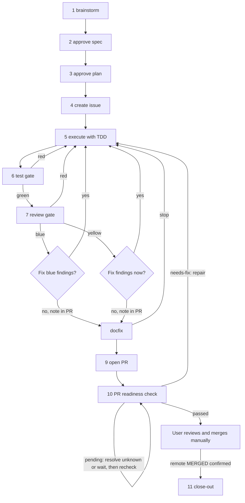

# Skills

AI coding-agent plugins published from this repository. The `dev-flow` plugin supports Claude Code and Codex through host-specific metadata and workflow entry points, with shared standalone skills.

## Install and start

### Claude Code

```sh
/plugin marketplace add vincy-cheng/skills
/plugin install dev-flow@vincy-skills
```

Or install directly from GitHub:

```sh
claude plugin install https://github.com/vincy-cheng/skills.git
```

Start a feature or fix with `/new-feature <your idea>`. Run `/new-feature` without a new brief to resume the latest active run. The workflow uses the `gh` CLI to create GitHub issues and pull requests.

The plugin also provides `/new-idea` for documenting an idea before building it.

### Codex

Add the marketplace from GitHub:

```sh
codex plugin marketplace add vincy-cheng/skills
```

In Codex, open the **Plugins Directory**, select **Vincy Skills (Codex)**, and install `dev-flow`. Restart the Codex desktop app after installation. Invoke `$dev-flow:new-feature` with a brief to start, or without a new brief to resume the latest active run.

For a local checkout, add the marketplace from the repository root:

```sh
codex plugin marketplace add .
```

After updating a local checkout, refresh it with `codex plugin marketplace upgrade vincy-skills` and restart Codex.

### Per-step reviewer groups

Both hosts can select a reviewer list per review step in the target repo's gitignored `.dev-flow/config.json`. `codex_reviewers` contains exact native Codex model names; `reviewers` contains Claude Code lane values. The supported keys are `red_team`, `plan_review`, `main_review`, and `focused_review`. A list starts one independent reviewer per entry. The example configures two red-team reviewers, one plan reviewer, and two focused reviewers; the main-review group inherits the existing reviewer selection because it is omitted:

```json
{
  "codex_reviewers": {
    "red_team": ["<native-model-a>", "<native-model-b>"],
    "plan_review": ["<native-model-a>"],
    "focused_review": ["<native-model-a>", "<native-model-b>"]
  },
  "reviewers": {
    "red_team": ["session", "claude:<model-name>"],
    "plan_review": ["session"],
    "focused_review": ["session", "claude:<model-name>"]
  },
  "codex_reviewer_model": "<available-native-model>",
  "codex_implementer_model": "<available-native-model>"
}
```

Configure only the active host's map. Codex uses `codex_reviewers` and ignores `reviewers`; Claude Code uses `reviewers` and ignores `codex_reviewers`. A configured list overrides that step's existing selection. An omitted step inherits its existing route: Codex uses `codex_reviewer_model`, then the session default; Claude Code keeps its state/config/standalone precedence. A valid override can be used even when an unused legacy default is unavailable. Bootstrap preserves existing `codex_reviewers` and `reviewers` maps and other config keys, and does not add either optional map to a new default config.

Every member must finish and clear the step's verdict rules; a majority cannot waive a blocker. After edits, rerun the whole affected group on the revised materials. Reviewers run independently in parallel up to host slots, with the remaining entries queued; the full configured count remains in force. Focused review still runs only after main-review clearance and its existing high-risk trigger. Plan reviewers combine coverage and adversarial review in one pass. Architectural designs require recorded completed red-team evidence before approval; bounded designs retain their self-check, and existing explicit trivial-plan self-check exceptions remain. Multiple reviewers increase dispatch and rework cost. See [model routing](references/model-routing.md#per-step-reviewer-groups) for validation, batch evidence, verdicts, and resume rules.

### Native model selection

On Codex, the separate `codex_reviewer_model` and `codex_implementer_model` settings select legacy reviewer and native implementation defaults. Replace the model placeholders with names supported by the current native subagent tool, then merge your existing branch and role settings. The implementer key selects native implementation subagents; at step 5 or in standalone execution, Codex asks for execution mode and implementation model together. An explicit `inline` choice runs in the session model, and `session` uses the selected native model. The confirmed choice is saved in the run state and reused on resume, with availability revalidated before each dispatch. Empty, malformed, unavailable, or rejected selections produce `BLOCKED` rather than a fallback.

Claude Code ignores both legacy Codex model keys and routes implementation through `roles.implementer`; omitted reviewer steps keep the existing `roles.reviewer` precedence. On Codex, external CLI lanes (`cli:<tool>/<model>`) keep their behavior unchanged. Omitting `codex_implementer_model` selects its session default; `codex_reviewer_model` is the reviewer fallback only for steps without a `codex_reviewers` override. See [model routing](references/model-routing.md) for validation, host precedence, lane details, and isolated brief boundaries.

## The `dev-flow` workflow

`dev-flow` guides a feature or fix through 11 steps in four phases:

| Phase | Steps | Work |
|-------|-------|------|
| Plan | 1–4 | Brainstorm, approve a spec, plan, create a GitHub issue |
| Build | 5 | Execute the plan with TDD and per-task commits |
| Verify | 6–8 | Test, review, and fix documentation drift |
| Ship | 9–11 | Open or update a pull request, check readiness, wait for the user's manual merge, close out the run |

The hard gate keeps steps in order. Gitignored state files and an index track each run so work can resume. Specs, plans, and state are stored under `docs/features/` and are not committed. Every workflow step uses a `dev-flow` skill; the plugin has no external plugin dependencies. The workflow loads only current-step guidance, reuses unchanged guidance, and gives isolated workers bounded briefs.



For requests spanning independent subsystems, step 1 can create an overview spec that records the sub-projects, order, dependencies, and deferred work. Each sub-project gets its own `/new-feature` run. Close-out updates the overview and prints the next run's command.

### Workflow skills

| Skill | Step | Purpose |
|-------|------|---------|
| `brainstorm` | 1 | Work through the design and write an approved spec |
| `plan` | 3 | Turn the spec into a contract-first implementation plan, gated by a plan review pass — an independent reviewer for ordinary and high-risk work, a recorded author self-check for small low-risk plans (≤3 tasks, one existing behavior, shared context, no unresolved dependencies) |
| `create-github-issue` | 4 | Draft and confirm an issue, then create a feature or fix branch off the state file's Target branch |
| `execute-tasks` | 5 | Complete planned tasks with TDD and a commit per task; on Claude Code, dispatches per the Roles block lane (inline, session, claude:<name>, or cli:<tool>/<model>); on Codex, native `session` uses the saved `codex_implementer_model`. The step-5 ask also confirms the Implementer context — `shared` carries one worker across related tasks, `per-task` keeps the existing fresh-worker-per-task default, `not-used` is inline |
| `tdd` | — | Test-first engine used by `execute-tasks` |
| `test` | 6 | Fresh tester subagent (per the Roles block's Tester lane) runs the repo's test and lint commands and scans changed tests for honesty |
| `review` | 7 | Fresh reviewer checks spec and plan coverage, obvious issues, and maintainability; high risk tiers (from the step-7 recheck) also get a focused category-matched reviewer |
| `doc-fix` | 8 | Find and fix documentation drift caused by the run |
| `open-pr` | 9 | Open or update the recorded pull request and sync the issue; never merges |
| `new-feature` | 10 | Check remote PR state and readiness against matching test/review evidence; report readiness and wait for the user's manual merge |

These skills can also run on their own. The test skill uses each target repository's test and lint commands; this repository's suite is `bash tests/check.sh` and it has no linter.

### Standalone commands and skills

| Piece | Purpose |
|-------|---------|
| `/new-feature` command | Claude Code workflow orchestrator; starts or resumes a feature or fix |
| `new-feature` skill | Codex workflow orchestrator (`$dev-flow:new-feature`) |
| `/new-idea` command | Discuss an idea, then scaffold its research and planning documents |
| `commit` skill | Write Conventional Commit messages without AI attribution |
| `document-structure` skill | Generate or update agent-facing documentation in a target repo's `docs/agents/` |
| `whats-new` skill | Summarize recent work and check for documentation drift |
| `standardize-prose` skill | Standardize spec/plan prose for human readers (adapted from ASD-STE100, guided, standalone; non-English docs supported — rare/translated terms cited, per-term) |

## `/new-idea`: capture an idea before building

Run `/new-idea <your idea>` in any repository. It asks whether the folder should be nested (`ideas/<project>/<slug>/`) or flat (`ideas/<slug>/`), and whether to include cost research.

By default it creates five self-contained documents: `README.md`, `research.md`, `design.md`, `plan.md`, and `tl-dr.md`. If requested, it adds `cost.md` with pricing, quotas, and limits. The plan is a milestone draft that can seed `/new-feature` later.

Before creating files, the command discusses and grills the idea, summarizes the decisions, and gets your explicit go-ahead. To build from the resulting folder, run `/new-feature ideas/<slug>`; the workflow uses the folder as its brief and links it from the GitHub issue.

## Session help

The plugin ships a hooks component (`hooks/` at the plugin root) that surfaces run state in your session, reading `docs/features/.feature-states/` live. Three behaviors:

- **Status line (ambient):** `dev-flow: <feat> · step 6/11 · test · 45m` — the current run, its step, and how long the step has been running. Updated at session start and after every turn; cleared when no run is active. Duration comes from the state file's `Status since:` field; state files written before that field existed show no duration.
- **Band pane opener (always drawn):** the **`[ Flow ]` button** on the band row above the prompt opens a compact card of the current run — step and status, an 11-step lifecycle list rendered vertically (one row per step: done ✓ / current ▸ / upcoming ·, full names at any pane width), tasks/issue/branch refs, and the next step with the skill that runs it. The press works mid-response too: the pane appears while Claude is still answering. In the classic terminal renderer mouse clicks don't register — run `/tui fullscreen`. **Resuming:** a Resume section lists the unfinished runs (active plus merged-with-close-out-pending; `done` never) — one `[ Resume ]` press submits the resume prompt and closes the pane; the run's own card carries its coverage, so it is not listed again. With nothing resumable the pane names the manual path: `/new-feature resume`. No active run → a hint to start one with `/new-feature <idea>`. When the run finishes (`done`/`merged`), the pane closes itself with a farewell toast; a pane you re-open after that stays open showing the final state.
- **Step toast:** when a run's Goal status flips between turns — `dev-flow: <feat> execute → test (step 6/11)`.

**Closing the pane:** the pane carries its own **`[ Close ]` button** — the reliable path, and the one that works mid-response (the host's `Esc` interrupts a running response before it closes anything); the Resume section, when drawn, renders above it under a divider. `Esc` closes the pane when it holds focus, between turns; some hosts also offer the frame's close mark or `ctrl+x x`. The mod never opens a pane on its own. The band's `[-]` mark is the host engine's, not the plugin's: it collapses the whole band row — every mod's row in it, `[ Flow ]` included — and re-expanding brings the button back.

**Placement** is the host surface's call, not the plugin's: in terminal hosts, a docked (right-side) pane needs **fullscreen rendering** — run `/tui fullscreen` to enable it (in the classic renderer the pane sits inline above the prompt, and mouse clicks on its buttons don't register). On other hosts the surface decides; the plugin has no placement setting.

**The 11 steps**, for reference (the status line and pane show these):

| Step | Status | Skill that advances it |
|------|--------|------------------------|
| 1 | brainstorm | `dev-flow:brainstorm` |
| 2 | spec | (brainstorm's approval writes the spec) |
| 3 | planning | `dev-flow:plan` |
| 4 | issue | `dev-flow:create-github-issue` |
| 5 | execute | `dev-flow:execute-tasks` |
| 6 | test | `dev-flow:test` |
| 7 | review | `dev-flow:review` |
| 8 | doc-fix | `dev-flow:doc-fix` |
| 9 | pr-review | `dev-flow:open-pr` |
| 10 | pr-review → merged | Check readiness at `pr-review`; set `merged` only after remote merge confirmation |
| 11 | done | close-out via `/new-feature` |

**Developing the hooks:** the authoritative gates are the host tools — `claude plugin validate .` and `claude plugin test .` (run both after touching `hooks/`). The bash suite (`bash tests/check.sh`) carries only thin structural guards (`tests/checks/07-hooks.sh`).

## Repository guide

- Repo root = plugin root: `skills/`, `commands/`, `hooks/`, `evals/` at the top level; host manifests in `.claude-plugin/` (Claude) and `.codex-plugin/` (Codex)
- `.agents/plugins/marketplace.json` — repository-local Codex plugin catalog
- `tests/check.sh` — bash consistency checks (thin runner + grouped fragments under `tests/checks/`); run after editing skills or commands
- `evals/` — behavioral evals for `brainstorm`, `plan`, `tdd`, `new-feature`, `review`, and `context-efficiency`, run manually with `claude plugin eval`
- `AGENTS.md` — repository guidance; `CLAUDE.md` links to the same file
- `docs/agents/INDEX.md` — starting point for the agent-facing architecture and dev-ops maps

## Acknowledgements

The `dev-flow` workflow and its early planning engine were inspired by [obra/superpowers](https://github.com/obra/superpowers). The plugin now provides its own skills for the workflow, and all artifacts stay under `docs/features/`.

The `tdd` skill's **seams** concept (testing at public boundaries rather than internals) comes from Kent Beck's *Test-Driven Development: By Example*, encountered through Matt Pocock's skill collections ([mattpocock-skills](https://github.com/mattpocock/skills)).

The `review` skill's clean-code pass draws on Robert C. Martin's *Clean Code*, [wojteklu's clean-code checklist](https://gist.github.com/wojteklu/73c6914cc446146b8b533c0988cf8d29), and the r/cleancode community guide; it is housed at `skills/review/references/clean-code.md`.

The `standardize-prose` skill's writing rules are adapted in spirit from ASD-STE100 Simplified Technical English Issue 9, owned by ASD — Aerospace, Security and Defence Industries Association of Europe; the skill paraphrases the rules and ships no STE text ([official PDF](https://www.asd-ste100.org/assets/files/ASD-STE100_ISSUE9.pdf)).
